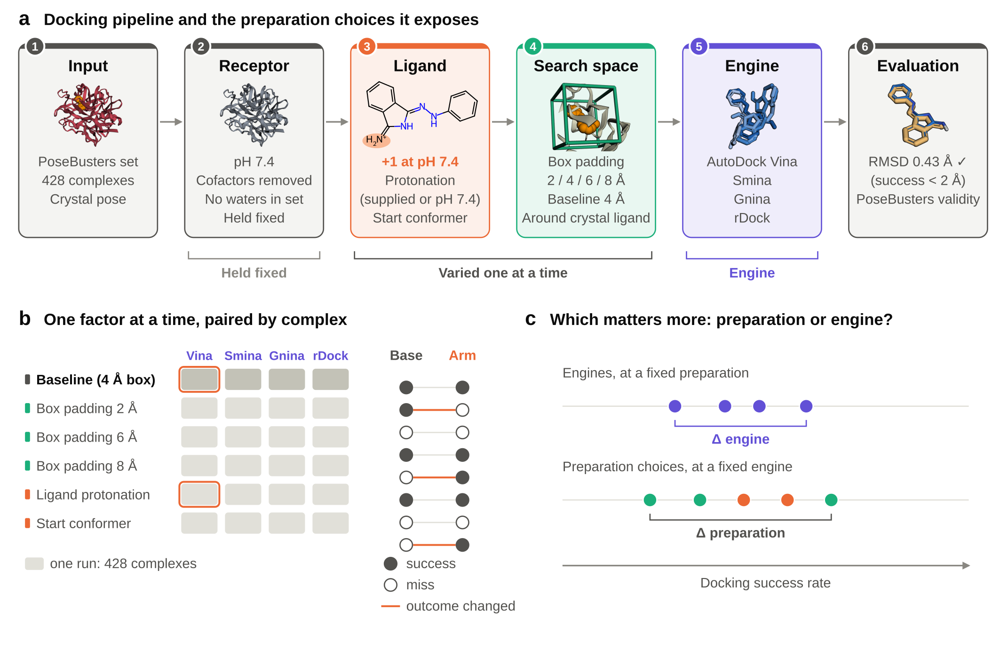
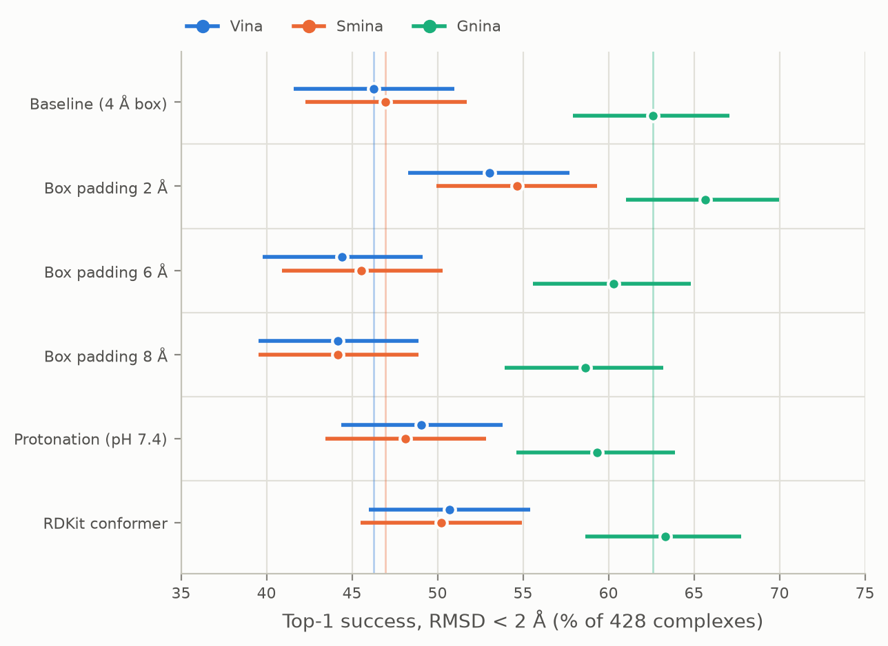

# DockPrepBench

[](https://github.com/David-Alobo/DockPrepBench/actions/workflows/ci.yml)
[](https://github.com/David-Alobo/DockPrepBench/actions/workflows/paper.yml)
[](https://david-alobo.github.io/DockPrepBench/)
[](LICENSE)
[](pyproject.toml)

**How much does preparation matter in molecular docking, compared with the choice of engine?**

Docking benchmarks usually compare engines under one fixed preparation protocol, yet every study
prepares its inputs differently. DockPrepBench changes one preparation choice at a time, docks
all 428 complexes of the PoseBusters Benchmark set with each of four engines, and compares every
arm with its baseline complex by complex.



**Key findings** (Vina, Smina and Gnina; rDock is being added):

- **Preparation moves top-1 success by 7 to 10.5 points within an engine.** Differences of a few
  points between engines, measured under one protocol, are within what preparation alone produces.
- **The search box matters most.** A tight box (2 Å padding around the reference ligand) raised
  Vina from 46.3% to 53.0% and Smina from 47.0% to 54.7%, the only effects that survive Holm
  correction. Larger boxes sent top poses to wrong sites in every engine.
- **Net rates hide most of the effect.** Every arm changed the outcome of more complexes than a
  change of docking seed did, up to 4.9 times as many, but gains and losses largely cancelled.
- **The engine still matters most.** Gnina's CNN re-scoring put it 16.4 points above Vina at the
  same protocol; the best preparation closed about 40% of that gap.

## Results

Top-1 success (heavy-atom RMSD < 2 Å) on all 428 complexes, with 95% Wilson intervals.



| Arm | Vina | Smina | Gnina |
|---|---|---|---|
| Baseline (4 Å box, supplied ligand) | 46.3 | 47.0 | 62.6 |
| Box padding 2 Å | **53.0** | **54.7** | 65.7 |
| Box padding 6 Å | 44.4 | 45.6 | 60.3 |
| Box padding 8 Å | 44.2 | 44.2 | 58.6 |
| Protonation at pH 7.4 | 49.1 | 48.1 | 59.3 |
| RDKit start conformer | 50.7 | 50.2 | 63.3 |

Bold: different from the same engine's baseline after Holm correction (exact McNemar test on the
paired outcomes). The manuscript in [`paper/`](paper/) gives intervals, gained and lost
complexes, PoseBusters validity, failure modes, the seed noise floor and a comparison with the
published PoseBusters Vina run.

**[Browse every complex, engine and pose in 3D in the results explorer →](https://david-alobo.github.io/DockPrepBench/)**

## Scope

| | |
|---|---|
| **Engines** | AutoDock Vina 1.2.7, Smina, Gnina (CNN re-scoring), rDock (in progress) |
| **Dataset** | PoseBusters Benchmark set, 428 complexes (and the 308-complex subset of the journal paper) |
| **Arms** | Box padding 2 / 6 / 8 Å, ligand protonation at pH 7.4, RDKit start conformer; baseline 4 Å |
| **Metrics** | Top-1 success (RMSD < 2 Å), PoseBusters validity, wrong-site and sampling failures |
| **Statistics** | Wilson intervals, exact McNemar tests with Holm correction, a four-seed noise floor |

## Installation

Requires [uv](https://docs.astral.sh/uv/).

```bash
uv sync
uv run pytest
```

The pipeline runs on CPU. A GPU is optional and only speeds up Gnina.

Docking engines run on **Linux x86_64** only (the `vina` Python bindings ship Linux wheels only, and
Gnina and rDock are Linux-only). On Windows or macOS the library installs and the unit tests run, while
engine tests are skipped; use WSL, a Linux machine or CI to dock.

On a Linux machine or shared server, one script installs everything in user space (uv, the
Python environment, Smina, Gnina with cuDNN 9, rDock and Open Babel), keeps caches out of your
home directory and finishes by running the tests:

```bash
scripts/setup.sh --tools-dir /path/with/space/tools   # add --no-gnina to skip the 2 GB Gnina binary
source /path/with/space/tools/env.sh
uv run dockprepbench run --engine smina --workers 16 --config configs/*.toml
```

Engines: `--engine vina|smina|gnina|rdock`; Gnina spreads workers over GPUs with `--gpus 0,1,2`.

## Usage

Docking runs on Linux (see Installation). Redock the PoseBusters benchmark set with Vina
(downloads the data to `data/raw` on first run):

```bash
uv run dockprepbench run --workers 8                                   # baseline protocol
uv run dockprepbench run --config configs/box_padding_2.toml --workers 8
```

Each preparation protocol is a TOML file in [`configs/`](configs/) that states only what it
changes from the baseline. A run writes `results.csv` (one row per complex: top-1 RMSD,
PoseBusters validity, score, runtime, any error) and `run.json` (config, engine settings,
version) to `results/<engine>/<config name>/`. Prepared receptors are cached in
`data/prepared/`, shared between configs that prepare the receptor identically.

```bash
uv run dockprepbench summarize results/vina/baseline
uv run dockprepbench compare results/vina/baseline results/vina/box_padding_2
```

`summarize` reports top-1 and PB-valid success rates with 95% Wilson intervals. `compare`
pairs two runs on their shared complexes, reports an exact McNemar test and lists the
complexes whose outcome changed. Use `--limit N` on `run` for a quick check.

### Results explorer

The explorer is online at **https://david-alobo.github.io/DockPrepBench/**: success by arm, how
outcomes moved between the baseline and an arm, and every complex with its docked poses in 3D.
To browse your own runs locally:

```bash
scripts/explorer.sh                  # every engine; then open http://localhost:8000/
scripts/explorer.sh --engine gnina --open
```

The script builds the page's data from `results/` and serves it locally; `scripts/publish_explorer.sh`
publishes it to GitHub Pages. See [explorer/README.md](explorer/README.md).

## Project layout

```
src/dockprepbench/
├── datasets/      benchmark download, curation and splits
├── preparation/   receptor and ligand preparation variants
├── engines/       docking engine wrappers
├── evaluation/    RMSD, PoseBusters validity, enrichment
├── analysis/      aggregation, statistics, figures
├── benchmark.py   run an engine over a dataset and score poses
├── io.py          structure file I/O
├── log.py         logging setup
└── cli.py         `dockprepbench` command
configs/           preparation protocols (TOML), one per experiment arm
tests/             pytest suite mirroring the package
docs/              documentation
scripts/           one-off utilities
```

See [docs/methods.md](docs/methods.md) for the benchmark protocol, [docs/architecture.md](docs/architecture.md)
for how the stages fit together, and
[CONTRIBUTING.md](CONTRIBUTING.md) for the development workflow.

## Roadmap

- [x] Packaging, tests, CI
- [x] Vina, Smina and Gnina on the full PoseBusters set, with PoseBusters validity checks
- [x] Preparation arms, paired statistics and the seed noise floor
- [x] Results explorer and manuscript draft
- [ ] rDock on all arms
- [ ] Interaction runs (protonation × box size) and a box scaled to ligand size
- [ ] Preprint on ChemRxiv and an archived release

## License

MIT
